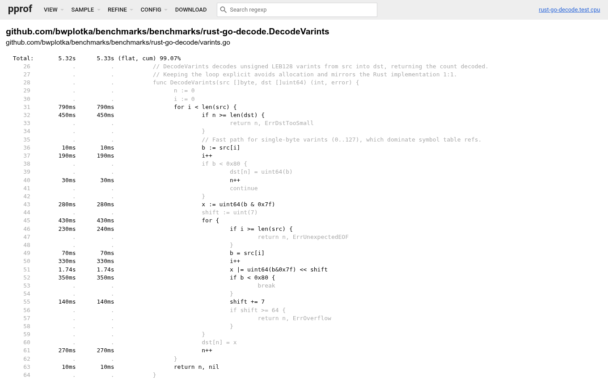
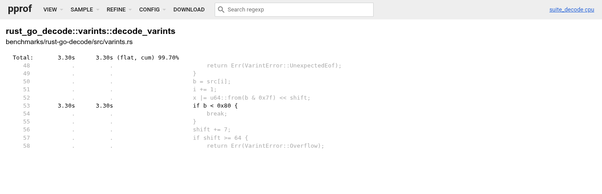

> **TL;DR:** I built [`benchfmt.rs`](https://github.com/bwplotka/benchfmt.rs), a zero-dependency Rust benchmark runner and [`Criterion`](https://crates.io/crates/criterion) converter for Go's [`benchstat`](https://pkg.go.dev/golang.org/x/perf/cmd/benchstat). It adds `/key=value` projections, heap tracking for allocated bytes (`B/op`) and objects (`allocs/op`) per op, and `pprof` profiling. 
> 
> In this post, I am benchmarking `varint` and [Prometheus Remote Write 2.0](https://prometheus.io/docs/specs/prw/remote_write_spec_2_0/) decoding across Go and Rust to showcase the benefits of `benchstat`-like flow in Rust. I'm also sharing some fun learnings on the way (e.g., yes [Rust is faster](#summary)).

Recently, I've been working on a few Rust projects across Google and [open source](https://github.com/prometheus/expfmt-rs). I came to Rust after years of writing performance-sensitive Go in [Prometheus](https://prometheus.io/), [Thanos](https://thanos.io/), and teaching Go in the ["Efficient Go" book](/book). For me, much of Rust's performance story is really good, until.... **I wanted to run A/B microbenchmarks**. 

Perhaps I was spoiled by the Go benchmarking ecosystem, with [the `go tool -bench` and `benchstat`](/2024/go-microbenchmarks-benchstat/) in the center. To me, Rust standard benchmarking tools are lacking:

* Standard format for case comparison projections.
* Standard heap allocation measurements.
* Standard `pprof` support.
* Simple to understand reliability scoring.

> **DISCLAIMER:** A `standard` here means something that will be familiar to large number of developers, and I biased on Go experience for sure!

As a result, I asked myself: can we get [`benchstat`](https://pkg.go.dev/golang.org/x/perf/cmd/benchstat)-compatible output for Rust microbenchmarks? Wouldn't that make A/B testing easier and unlock fun Go vs Rust comparisons?

**Here we are!** I built [`benchfmt.rs`](https://github.com/bwplotka/benchfmt.rs), a zero-dependency Rust benchmark runner with a thread-local heap allocation counter, `pprof` profiler integration, and the same CLI flags as `go test -bench`. For those who don't trust a new benchmarking runtime (you shouldn't from the start!), it also ships a [`Criterion`](https://crates.io/crates/criterion) and `libtest` converter that emits Go's [`benchfmt`](https://go.googlesource.com/proposal/+/master/design/14313-benchmark-format.md) format directly.

In this blog post, we will implement the same pieces of code in Go and Rust, benchmark them across different Rust frameworks, and compare the results. We might learn something new along the way (I did when building this!). Enjoy! 

All benchmark code and raw outputs live in [`bwplotka/benchmarks/benchmarks/rust-go-decode`](https://github.com/bwplotka/benchmarks/tree/c55bd342d9ac23e788d06327dc7973951a5eeb82/benchmarks/rust-go-decode).

## Benchmarking two workloads

Let's pick two workloads to implement and benchmark in both Go and Rust. I am particularly curious about protobuf decoding performance, which, funny enough, is often one of the main costs of running distributed systems these days. Thus, let's decode our [Prometheus Remote Write 2.0 protocol](https://prometheus.io/docs/specs/prw/remote_write_spec_2_0/). Because protobuf code generators have different maturity and trade-offs across languages, let's also measure something simpler alongside it, a standalone `varint` decoder.

### Workload details:

1. **`DecodeVarints`.** A 36-line unsigned LEB128 varint stream decoder. Varints are the integer encoding underneath Protocol Buffers. Our fixture `varints_2000.bin` is `4,798` bytes and packs `2,000` `uint64` values mixing 1-byte symbol indices, 2-byte bucket offsets, 4-byte deltas, and 6-byte millisecond Unix timestamps. The function writes into a preallocated `2,000`-element slice with zero heap allocations.
2. **`DecodeRemoteWrite2`.** A full HTTP request body decoder for Snappy-compressed Remote Write 2.0 (`io.prometheus.write.v2.Request`) payloads. We test batches of `200` and `2,000` series, where `2,000` matches Prometheus's default `max_samples_per_send`. The `2,000`-series fixture mixes counters, gauges, classic and native histograms, `1,000` trace exemplars, and metric metadata. Remote Write 2.0 interns all strings into a top-level `symbols` table and stores packed varint `labels_refs` per series. That shrinks the `2,000`-series batch to `244.9 KiB` uncompressed and `57.0 KiB` Snappy-compressed.

## Implementing and benchmarking in Go

Let's start with Go. First, `DecodeVarints` writes straight into a caller-provided slice, with a fast path for single-byte values below `0x80`:

```go
func DecodeVarints(src []byte, dst []uint64) (int, error) {
	n := 0
	i := 0
	for i < len(src) {
		if n >= len(dst) {
			return n, ErrDstTooSmall
		}
		b := src[i]
		i++
		if b < 0x80 {
			dst[n] = uint64(b)
			n++
			continue
		}
		x := uint64(b & 0x7f)
		shift := uint(7)
		for {
			if i >= len(src) {
				return n, ErrUnexpectedEOF
			}
			b = src[i]
			i++
			x |= uint64(b&0x7f) << shift
			if b < 0x80 {
				break
			}
			shift += 7
			if shift >= 64 {
				return n, ErrOverflow
			}
		}
		dst[n] = x
		n++
	}
	return n, nil
}
```

Second, for `DecodeRemoteWrite2`, we tune the Go implementation the way Prometheus runs in production rather than benchmarking slow reflection-based unmarshaling. We pair [`github.com/golang/snappy`](https://github.com/golang/snappy), which uses x86-64 assembly on `linux/amd64`, with [`vtprotobuf`](https://github.com/planetscale/vtprotobuf) and its generated, optimized `UnmarshalVT` decoder:

```go
func DecodeRemoteWrite2(compressed []byte) (*writev2.Request, error) {
	raw, err := snappy.Decode(nil, compressed)
	if err != nil {
		return nil, err
	}
	req := &writev2.Request{}
	if err := req.UnmarshalVT(raw); err != nil {
		return nil, err
	}
	return req, nil
}
```

Now let's measure the efficiency of our Go code!

Notice Go's `/key=value` sub-benchmark names (`samples=2000/lang=go`), which let Go's official [`benchstat`](https://pkg.go.dev/golang.org/x/perf/cmd/benchstat) tool pivot across `/lang` or `/samples` later, along with `b.SetBytes`, `b.ReportAllocs`, and `for b.Loop()`:

```go
func BenchmarkDecodeVarints(b *testing.B) {
	manifest := ensureFixtures(b)
	raw, err := os.ReadFile(filepath.Join("testdata", "varints_2000.bin"))
	if err != nil {
		b.Fatalf("read varints: %v", err)
	}
	dst := make([]uint64, manifest.VarintsCount)

	// Encode dimensions as /key=value so benchstat can pivot across /samples or /lang.
	b.Run("samples=2000/lang=go", func(b *testing.B) {
		b.SetBytes(int64(len(raw)))
		b.ReportAllocs()
		// NOTE: b.Loop() resets the timer on its first call, stops it on exit, and keeps
		// call arguments and results alive without package-level sink variables.
		for b.Loop() {
			n, err := DecodeVarints(raw, dst)
			if err != nil || n != manifest.VarintsCount {
				b.Fatalf("unexpected decode result: n=%d err=%v", n, err)
			}
		}
	})
}

func BenchmarkDecodeRemoteWrite2(b *testing.B) {
	ensureFixtures(b)

	for _, samples := range []int{200, 2000} {
		file := fmt.Sprintf("rw2_%d.snappy", samples)
		compressed, err := os.ReadFile(filepath.Join("testdata", file))
		if err != nil {
			b.Fatalf("read %s: %v", file, err)
		}

		b.Run(fmt.Sprintf("samples=%d/lang=go", samples), func(b *testing.B) {
			b.SetBytes(int64(len(compressed)))
			b.ReportAllocs()
			for b.Loop() {
				req, err := DecodeRemoteWrite2(compressed)
				if err != nil || len(req.Timeseries) != samples {
					b.Fatalf("unexpected v2 decode: err=%v", err)
				}
			}
		})
	}
}
```

Finally, let's run `6` benchmark runs ("epochs") for `2s` each at `-cpu 2` on a 24-core Intel Xeon 2.20GHz Linux workstation (Go 1.26.8, Rust 1.99.1):

```bash
go test -run '^$' -bench '^BenchmarkDecode' \
    -benchtime 2s -count 6 -cpu 2 -timeout 999m -benchmem \
| tee results/go.txt
```

One epoch looks as follows:

```text
goos: linux
goarch: amd64
pkg: github.com/bwplotka/benchmarks/benchmarks/rust-go-decode
cpu: Intel(R) Xeon(R) CPU @ 2.20GHz
BenchmarkDecodeVarints/samples=2000/lang=go-2          279861      8514 ns/op   563.52 MB/s        0 B/op        0 allocs/op
BenchmarkDecodeRemoteWrite2/samples=200/lang=go-2        8467    264321 ns/op    31.43 MB/s   195296 B/op     2189 allocs/op
BenchmarkDecodeRemoteWrite2/samples=2000/lang=go-2        976   2448633 ns/op    23.84 MB/s  1643970 B/op    19297 allocs/op
```

## Implementing and benchmarking in Rust with Criterion

Now let's port both decoders and benchmarks to Rust. First, `decode_varints` mirrors the Go loop line for line:

```rust
pub fn decode_varints(src: &[u8], dst: &mut [u64]) -> Result<usize, VarintError> {
    let mut n = 0usize;
    let mut i = 0usize;
    while i < src.len() {
        if n >= dst.len() {
            return Err(VarintError::DstTooSmall);
        }
        let mut b = src[i];
        i += 1;
        if b < 0x80 {
            dst[n] = u64::from(b);
            n += 1;
            continue;
        }
        let mut x = u64::from(b & 0x7f);
        let mut shift = 7u32;
        loop {
            if i >= src.len() {
                return Err(VarintError::UnexpectedEof);
            }
            b = src[i];
            i += 1;
            x |= u64::from(b & 0x7f) << shift;
            if b < 0x80 {
                break;
            }
            shift += 7;
            if shift >= 64 {
                return Err(VarintError::Overflow);
            }
        }
        dst[n] = x;
        n += 1;
    }
    Ok(n)
}
```

Second, `decode_remote_write2` pairs the [`snap`](https://crates.io/crates/snap) crate with [`prost`](https://crates.io/crates/prost) compile-time generated `Message` structs:

```rust
pub fn decode_remote_write2(compressed: &[u8]) -> Result<proto::v2::Request, String> {
    let raw = snap::raw::Decoder::new()
        .decompress_vec(compressed)
        .map_err(|e| e.to_string())?;
    proto::v2::Request::decode(raw.as_slice()).map_err(|e| e.to_string())
}
```

Now, let's write both Rust benchmarks using [`Criterion`](https://crates.io/crates/criterion), the default choice for stable-Rust microbenchmarking. We keep the same `/key=value` benchmark IDs and configure `Throughput::BytesDecimal` to match Go's decimal `MB/s`:

```rust
fn bench_varints(c: &mut Criterion) {
    // Resolve testdata/ from the crate directory baked in at compile time.
    let root = Path::new(env!("CARGO_MANIFEST_DIR")).join("testdata");
    let raw = fs::read(root.join("varints_2000.bin")).unwrap();
    // Preallocate the output buffer outside the timed loop so each op does 0 heap allocs.
    let mut dst = vec![0u64; 2000];

    // Group + function ID join into "DecodeVarints/samples=2000/lang=rust" to match Go's b.Run.
    let mut group = c.benchmark_group("DecodeVarints");
    // Report decimal MB/s (1e6 B/s) to match Go's b.SetBytes; Throughput::Bytes prints MiB/s.
    group.throughput(Throughput::BytesDecimal(raw.len() as u64));
    group.bench_function("samples=2000/lang=rust", |b| {
        // b.iter runs the closure across Criterion's warmup and 100 linear-ramp samples.
        b.iter(|| {
            // std::hint::black_box is an LLVM optimization barrier: Unlike Go's b.Loop(), Rust
            // would constant-fold known inputs or delete unused work without black_box hints.
            let n = decode_varints(black_box(&raw), black_box(&mut dst)).unwrap();
            assert_eq!(n, 2000);
            // Observe the written buffer so LLVM cannot optimize away stores into dst.
            black_box(dst[n - 1]);
        });
    });
    group.finish();
}

fn bench_remote_write2(c: &mut Criterion) {
    let root = Path::new(env!("CARGO_MANIFEST_DIR")).join("testdata");
    let mut group = c.benchmark_group("DecodeRemoteWrite2");

    for samples in [200usize, 2000usize] {
        let file = format!("rw2_{samples}.snappy");
        let compressed = fs::read(root.join(file)).unwrap();

        group.throughput(Throughput::BytesDecimal(compressed.len() as u64));
        let id = format!("samples={samples}/lang=rust");
        group.bench_function(&id, |b| {
            b.iter(|| {
                let req = decode_remote_write2(black_box(&compressed)).unwrap();
                assert_eq!(req.timeseries.len(), samples);
                // Force req to materialize before dropping at the end of the iteration.
                black_box(req);
            });
        });
    }
    group.finish();
}

// Generate the benchmark group runner and custom main() required by harness = false in Cargo.toml.
criterion_group!(benches, bench_varints, bench_remote_write2);
criterion_main!(benches);
```

Finally, let's run the Criterion benchmark suite:

```bash
cargo bench --bench criterion_decode
```

```text
DecodeVarints/samples=2000/lang=rust
                        time:   [5.2789 µs 5.3369 µs 5.4014 µs]
                        thrpt:  [888.29 MB/s 899.02 MB/s 908.90 MB/s]

DecodeRemoteWrite2/samples=200/lang=rust
                        time:   [237.09 µs 238.48 µs 239.95 µs]
                        thrpt:  [34.620 MB/s 34.833 MB/s 35.037 MB/s]

DecodeRemoteWrite2/samples=2000/lang=rust
                        time:   [2.0712 ms 2.0831 ms 2.0968 ms]
                        thrpt:  [27.835 MB/s 28.018 MB/s 28.179 MB/s]
```

### Criterion downsides

Criterion is convenient when you want confidence intervals and HTML plots from a single `cargo bench` command without external tools. However, compared to `go test` and `benchstat`, four design choices get in the way:

1. **Compile weight.** Pulling in `criterion` with `default-features = false` still compiles `clap`, `regex-automata`, `ciborium`, `oorandom`, `itertools`, `tinytemplate`, and `anes`. That adds 42 transitive crates and ~19s to a cold `cargo bench` build.
2. **Linear-ramp sampling vs steady-state epochs.**
   * Go's `testing.B` calibrates a fixed iteration count `N` for `-benchtime 2s` and runs `-count 6` equal steady-state epochs, which `benchstat` summarizes using the outlier-resistant median and Mann-Whitney U test.
   * Criterion defaults to `Linear` sampling: after a 3-second warmup, it collects 100 batches of `[1d, 2d, ..., 100d]` iterations and fits a least-squares line `y = m * x` through the origin. Because the line is forced through zero, it does not subtract a fixed timer-overhead intercept. Instead, it computes a `k^2`-weighted average where batch 100 carries `10,000x` the weight of batch 1 and late OS spikes pull the slope up.

   Comparing those two models directly introduces two measurable distortions:
   * First, grouping Criterion's 100 ramp samples into 6 `benchstat` epochs gives epoch 1 `11.5x` fewer iterations than epoch 6 (`24,888` vs `286,212` on `DecodeVarints`). Mixing short bursts with long runs inflates variance to `± 5%`, compared to `± 1-2%` in steady-state epochs.
   * Second, timing 100 separate closure batches adds `+8.6%` overhead on microsecond loops (`5.36 µs` vs `4.90 µs`, `p=0.002`) and skews early allocating samples with cold allocator caches (`+2.3%` on `DecodeRemoteWrite2`).
3. **No heap allocation tracking.** Criterion reports wall-clock time and throughput only. On `DecodeVarints` at `0 allocs/op`, that is fine. On `DecodeRemoteWrite2`, we cannot tell whether `prost` made 500 heap allocations or 500,000, or whether a refactor doubled heap churn.
4. **Pairwise baseline folders vs multi-dimensional tables.** Criterion compares `target/criterion/<id>/base` against `new`. You cannot feed a single run file into a table that [pivots `-col /samples` or `-col /lang`](/2024/go-microbenchmarks-benchstat/) across Go and Rust.

## Converting Criterion output with the `benchfmt` CLI

If a Rust codebase already uses Criterion, rewriting benchmarks just to get a `benchstat` table is not ideal. That is why `benchfmt.rs` includes a standalone `benchfmt` CLI binary. It reads `benchmark.json` and `sample.json` directly from `target/criterion`, extracts `Throughput::BytesDecimal` (or `Throughput::Bytes`) as decimal `MB/s`, and groups Criterion's 100 samples into `6` contiguous epochs via `--epochs 6`:

```bash
cargo install --git https://github.com/bwplotka/benchfmt.rs

benchfmt criterion target/criterion \
    --pkg github.com/bwplotka/benchmarks/benchmarks/rust-go-decode \
    --cpu 2 \
> results/rust_criterion.txt

benchstat -col /lang results/go.txt results/rust_criterion.txt
```

Without touching the benchmark implementation, `benchstat` gives us a side-by-side Go vs Rust table:

```text
goos: linux
goarch: amd64
pkg: github.com/bwplotka/benchmarks/benchmarks/rust-go-decode
cpu: Intel(R) Xeon(R) CPU @ 2.20GHz
                                  │     go      │                rust                │
                                  │   sec/op    │   sec/op     vs base               │
DecodeVarints/samples=2000-2        8.536µ ± 1%   5.364µ ± 5%  -37.16% (p=0.002 n=6)
DecodeRemoteWrite2/samples=200-2    271.4µ ± 3%   235.1µ ± 4%  -13.37% (p=0.002 n=6)
DecodeRemoteWrite2/samples=2000-2   2.470m ± 5%   2.082m ± 1%  -15.72% (p=0.002 n=6)
geomean                             178.9µ        138.0µ       -22.87%

                                  │      go      │                rust                 │
                                  │     B/s      │     B/s       vs base               │
DecodeVarints/samples=2000-2        536.1Mi ± 1%   853.2Mi ± 5%  +59.15% (p=0.002 n=6)
DecodeRemoteWrite2/samples=200-2    29.19Mi ± 3%   33.70Mi ± 4%  +15.44% (p=0.002 n=6)
DecodeRemoteWrite2/samples=2000-2   22.53Mi ± 5%   26.74Mi ± 1%  +18.67% (p=0.002 n=6)
geomean                             70.65Mi        91.60Mi       +29.67%

                                  │       go       │
                                  │      B/op      │
DecodeVarints/samples=2000-2          0.000 ± 0%
DecodeRemoteWrite2/samples=200-2    190.7Ki ± 0%
DecodeRemoteWrite2/samples=2000-2   1.568Mi ± 0%
geomean                                          ¹
¹ summaries must be >0 to compute geomean

                                  │      go       │
                                  │   allocs/op   │
DecodeVarints/samples=2000-2         0.000 ± 0%
DecodeRemoteWrite2/samples=200-2    2.189k ± 0%
DecodeRemoteWrite2/samples=2000-2   19.30k ± 0%
geomean                                         ¹
¹ summaries must be >0 to compute geomean
```

Now, with this view we finally have a readable, standard `benchstat` output Go developers love. It clearly shows the Go vs Rust efficiency for our example functions. Rust is `37.16%` faster on `DecodeVarints` (`5.36 µs` vs `8.54 µs`) and `13.37%` to `15.72%` faster on `DecodeRemoteWrite2`.

Unfortunately, there are some gaps:
1. The `B/op` and `allocs/op` tables only have a `go` column because Criterion never recorded allocations
2. Criterion's linear-ramp epochs still leave `± 5%` variance on `DecodeVarints`.

## Native `benchfmt` runs with `benchfmt::Suite` and `CountingAlloc`

For new Rust benchmarks, we can skip Criterion and use `benchfmt::Suite`` with `harness = false` in `Cargo.toml`. Registering `CountingAlloc` as `#[global_allocator]` tracks every `alloc`, `alloc_zeroed`, and `realloc` in a `thread_local!` `Cell<(u64, u64)>` with zero atomic contention and zero external dependencies:

```rust
// Wrap Rust's System allocator globally so every heap alloc/realloc on the benchmark thread
// increments thread-local (allocs, bytes) counters for B/op and allocs/op.
#[global_allocator]
static ALLOC: CountingAlloc = CountingAlloc::new();

fn main() {
    let root = Path::new(env!("CARGO_MANIFEST_DIR")).join("testdata");
    let raw_varints = fs::read(root.join("varints_2000.bin")).unwrap();
    let rw2_200 = fs::read(root.join("rw2_200.snappy")).unwrap();
    let rw2_2000 = fs::read(root.join("rw2_2000.snappy")).unwrap();
    let mut dst = vec![0u64; 2000];

    // Parse go-test-compatible CLI flags (-bench, -benchtime, -count, -cpu, -benchmem,
    // -cpuprofile, -memprofile) from std::env::args() and set the default "pkg:" header.
    // Using the same pkg path as Go's go.mod lets `benchstat -col /lang` join Go and Rust rows.
    Suite::from_env("github.com/bwplotka/benchmarks/benchmarks/rust-go-decode")
        // Attach ALLOC so each benchmark snapshots thread-local allocation deltas per epoch.
        .with_alloc(&ALLOC)
        // Suite prepends "Benchmark" in benchfmt output, matching Go's BenchmarkDecodeVarints.
        .bench("DecodeVarints/samples=2000/lang=rust", |b| {
            b.set_bytes(raw_varints.len() as u64);
            b.report_allocs();
            // Go b.Loop() equivalent: starts timing, alloc snapshots, and any pprof capture on the
            // first call, runs the calibrated N steady-state iterations, then stops all three.
            while b.keep_running() {
                let n = decode_varints(black_box(&raw_varints), black_box(&mut dst)).unwrap();
                assert_eq!(n, 2000);
                black_box(dst[n - 1]);
            }
        })
        .bench("DecodeRemoteWrite2/samples=200/lang=rust", |b| {
            b.set_bytes(rw2_200.len() as u64);
            b.report_allocs();
            while b.keep_running() {
                let req = decode_remote_write2(black_box(&rw2_200)).unwrap();
                assert_eq!(req.timeseries.len(), 200);
                black_box(req);
            }
        })
        .bench("DecodeRemoteWrite2/samples=2000/lang=rust", |b| {
            b.set_bytes(rw2_2000.len() as u64);
            b.report_allocs();
            while b.keep_running() {
                let req = decode_remote_write2(black_box(&rw2_2000)).unwrap();
                assert_eq!(req.timeseries.len(), 2000);
                black_box(req);
            }
        })
        .run();
}
```

> **Does `CountingAlloc` work with Tokio and custom allocators?** Mostly yes. You can wrap custom allocators like `jemalloc` or `mimalloc` via `CountingAlloc::with_allocator(Jemalloc)`. Because `CountingAlloc` uses thread-local counters on the benchmark thread, single-threaded Tokio `current_thread` works out of the box, while multi-threaded pools like `tokio::spawn` or `rayon` need a process-wide atomic [`AllocTracker`](https://github.com/bwplotka/benchfmt.rs/blob/main/src/alloc.rs) passed to `Suite::with_alloc`.

`Suite::from_env` reads `std::env::args()`, auto-detects `goos`, `goarch`, and `cpu`, and writes the passed string as the `pkg:` metadata line (matching Go's module path so `benchstat` joins Go and Rust rows into one table). Passing flags after `--` mirrors `go test`:

```bash
cargo bench --bench suite_decode -- \
    -bench '^BenchmarkDecode' -benchtime 2s -count 6 -cpu 2 -benchmem \
| tee results/rust_suite.txt
```

First, let's verify that `benchfmt::Suite` agrees with Criterion on timing, even with `CountingAlloc` active on every allocation:

```bash
benchstat criterion=results/rust_criterion.txt suite=results/rust_suite.txt
```

```text
                                            │  criterion  │               suite               │
                                            │   sec/op    │   sec/op     vs base              │
DecodeRemoteWrite2/samples=2000/lang=rust-2   2.082m ± 1%   2.033m ± 2%  -2.33% (p=0.015 n=6)
DecodeRemoteWrite2/samples=200/lang=rust-2    235.1µ ± 4%   231.5µ ± 1%  -1.55% (p=0.004 n=6)
DecodeVarints/samples=2000/lang=rust-2        5.364µ ± 5%   4.902µ ± 2%  -8.60% (p=0.002 n=6)
geomean                                       138.0µ        132.1µ       -4.21%
```

On `DecodeRemoteWrite2`, Criterion and `benchfmt::Suite` agree within `1.6%` to `2.3%`, while `Suite`'s steady-state `2s` epochs tighten worst-case variance from `± 4-5%` down to `± 1-2%`. On `DecodeVarints`, `while b.keep_running()` runs `490,000` back-to-back iterations in one tight loop instead of 100 short ramp batches, clocking `4.90 µs` vs `5.36 µs`.

Now let's run the full Go vs Rust comparison with `results/rust_suite.txt`:

```bash
benchstat -col /lang results/go.txt results/rust_suite.txt
```

```text
goos: linux
goarch: amd64
pkg: github.com/bwplotka/benchmarks/benchmarks/rust-go-decode
cpu: Intel(R) Xeon(R) CPU @ 2.20GHz
                                  │     go      │                rust                │
                                  │   sec/op    │   sec/op     vs base               │
DecodeVarints/samples=2000-2        8.536µ ± 1%   4.902µ ± 2%  -42.56% (p=0.002 n=6)
DecodeRemoteWrite2/samples=200-2    271.4µ ± 3%   231.5µ ± 1%  -14.71% (p=0.002 n=6)
DecodeRemoteWrite2/samples=2000-2   2.470m ± 5%   2.033m ± 2%  -17.68% (p=0.002 n=6)
geomean                             178.9µ        132.1µ       -26.12%

                                  │      go      │                rust                 │
                                  │     B/s      │     B/s       vs base               │
DecodeVarints/samples=2000-2        536.1Mi ± 1%   933.3Mi ± 2%  +74.09% (p=0.002 n=6)
DecodeRemoteWrite2/samples=200-2    29.19Mi ± 3%   34.22Mi ± 1%  +17.23% (p=0.002 n=6)
DecodeRemoteWrite2/samples=2000-2   22.53Mi ± 5%   27.37Mi ± 2%  +21.48% (p=0.002 n=6)
geomean                             70.65Mi        95.62Mi       +35.35%

                                  │       go       │                 rust                  │
                                  │      B/op      │     B/op      vs base                 │
DecodeVarints/samples=2000-2          0.000 ± 0%       0.000 ± 0%        ~ (p=1.000 n=6) ¹
DecodeRemoteWrite2/samples=200-2    190.7Ki ± 0%     271.9Ki ± 0%  +42.59% (p=0.002 n=6)
DecodeRemoteWrite2/samples=2000-2   1.568Mi ± 0%     2.053Mi ± 0%  +30.98% (p=0.002 n=6)
geomean                                          ²                 +23.15%               ²
¹ all samples are equal
² summaries must be >0 to compute geomean

                                  │      go       │                 rust                 │
                                  │   allocs/op   │  allocs/op   vs base                 │
DecodeVarints/samples=2000-2         0.000 ± 0%      0.000 ± 0%        ~ (p=1.000 n=6) ¹
DecodeRemoteWrite2/samples=200-2    2.189k ± 0%     1.905k ± 0%  -12.97% (p=0.002 n=6)
DecodeRemoteWrite2/samples=2000-2   19.30k ± 0%     16.49k ± 0%  -14.55% (p=0.002 n=6)
geomean                                         ²                 -9.40%               ²
¹ all samples are equal
² summaries must be >0 to compute geomean
```

Look closely at the `B/op` and `allocs/op` tables. That is the kind of surprise you miss without allocation counters:

* Rust makes **14.55% fewer heap allocations** at `2,000` series (`16,490` vs Go's `19,297 allocs/op`). Go's `protoc-gen-go` generates pointer slices such as `[]*TimeSeries` and `[]*Sample`, allocating every nested struct separately on the heap. Rust's `prost` stores `Vec<TimeSeries>` and `Vec<Sample>` inline by value.
* Yet Rust requests **30.98% more heap bytes** at `2,000` series (`2.05 MiB` vs Go's `1.57 MiB`) and **42.59% more** at `200` series (`271.9 KiB` vs `190.7 KiB`)!

## Bonus: `go tool pprof` profiling to tell WHERE certain overhead exists benchmarks in Go and Rust

`benchstat` tells us *what* changed, while [`pprof`](https://github.com/google/pprof) tells us *why*. With `features = ["pprof"]` and `[profile.bench] debug = 1` in `Cargo.toml`, `benchfmt::Suite` supports the same `-cpuprofile`, `-memprofile`, and `-memprofilerate` flags as `go test`. Every `.pb.gz` file opens directly in `go tool pprof -http=:8080` or [`pprof.me`](https://pprof.me).

### CPU profiling `DecodeVarints`

`DecodeVarints` does zero heap allocations in both languages, yet Rust finishes in `4.90 µs` while Go takes `8.54 µs` for the same loop. Let's capture single-threaded CPU profiles from both runners:

```bash
go test -run '^$' -bench '^BenchmarkDecodeVarints$' -benchtime 5s -count 1 -cpu 1 \
    -cpuprofile /tmp/go_varints_cpu.pb.gz

cargo bench --bench suite_decode -- \
    -bench '^BenchmarkDecodeVarints/' -benchtime 3s -count 1 -cpu 1 \
    -cpuprofile /tmp/rust_varints_cpu.pb.gz
```

Opening the source view in `pprof` shows where each compiler spends its cycles:





Both languages spend over `99%` of CPU inside the varint loop. Go, however, burns **`1.74s` (`32.3%`)** on `x |= uint64(b&0x7f) << shift` alone and **`1.24s` (`23.0%`)** on the outer loop checks. Inspecting `go tool objdump` and `objdump -d` shows two codegen differences behind the `42.56%` gap:

1. **Loop unrolling and 64-bit shift masking.** Because `shift` steps by `7` up to `64` (at most 9 bytes), LLVM unrolls Rust's inner continuation loop. Every variable `<< shift` becomes a constant shift (`shl $0x7`, `shl $0xe`, `shl $0x15`, ...) with no `shift` counter or `shift >= 64` branch. Go keeps the inner loop rolled and defines `x << shift` as `0` when `shift >= 64`, whereas x86 `SHLQ CL` masks modulo 64. That forces Go to emit `SHLQ CL`, `CMPQ $64`, `SBBQ`, and `ANDQ` on every continuation byte.
2. **Signed `int` vs unsigned `usize` indices.** Go's `i` and `n` are signed `int`, so `i < len(src)` and `n >= len(dst)` do not prove non-negativity across the loop back-edge. Go emits duplicate unsigned `CMPQ`/`JBE` slice bounds checks before `src[i]` and `dst[n]`, while LLVM removes the inner checks on Rust's unsigned `usize` indices and inlines `decode_varints` into `while b.keep_running()`.

### CPU and heap profiling `DecodeRemoteWrite2`

Next, let's collect `-cpuprofile` and exact `-memprofile` captures on the `2,000`-series Remote Write 2.0 benchmark:

```bash
# CPU profiles: 3s at -cpu 1.
go test -run '^$' -bench '^BenchmarkDecodeRemoteWrite2/samples=2000/' -benchtime 3s -count 1 -cpu 1 \
    -cpuprofile /tmp/go_rw2_cpu.pb.gz
cargo bench --bench suite_decode -- \
    -bench 'DecodeRemoteWrite2/samples=2000' -benchtime 3s -count 1 -cpu 1 \
    -cpuprofile /tmp/rust_rw2_cpu.pb.gz

# Exact heap profiles: 50 iterations with every allocation sampled.
go test -run '^$' -bench '^BenchmarkDecodeRemoteWrite2/samples=2000/' -benchtime 50x -count 1 -cpu 1 \
    -memprofile /tmp/go_rw2_mem.pb.gz -memprofilerate 1
cargo bench --bench suite_decode -- \
    -bench 'DecodeRemoteWrite2/samples=2000' -benchtime 50x -count 1 -cpu 1 \
    -memprofile /tmp/rust_rw2_mem.pb.gz -memprofilerate 1
```

The two CPU flamegraphs show very different bottlenecks:

. Explore the <a href='https://pprof.me/7af23a8fbe6409728965b2db5072fb87' target='_blank' rel='noopener'>interactive profile on pprof.me</a>.")

. Explore the <a href='https://pprof.me/9041b44c87f5861a25f8cc5a280c47a3' target='_blank' rel='noopener'>interactive profile on pprof.me</a>.")

Go's x86-assembly `snappy.Decode` at `~0.12 ms/op` actually beats pure-Rust `snap` at `~0.18 ms/op`, and `vtprotobuf`'s own wire parsing takes only `~0.95 ms/op`. Go still loses overall because `runtime.mallocgc` and GC assist take `54.1%` of all on-CPU time, or `~1.34 ms/op`, allocating and scanning `19,297` heap objects.

In Rust, `71.1%` of CPU time goes to `prost` field decoding, `8.9%` to `snap` decompression, and `18.7%` to `RawVecInner::grow_amortized` under `Vec::push` and `Vec::reserve`. The `alloc_space` heap profiles show why `RawVecInner::grow_amortized` is so busy and why Rust allocates `30.98%` more `B/op` than Go:

. Explore the <a href='https://pprof.me/60e14eabe540995ce6cc1cabd0d6f0e2' target='_blank' rel='noopener'>interactive profile on pprof.me</a>.")

. Explore the <a href='https://pprof.me/1fb6663440810f6deb67f24c7829a079' target='_blank' rel='noopener'>interactive profile on pprof.me</a>.")

Go's `UnmarshalVT` preallocates slices and structs close to their final size, totaling `1.57 MiB/op`. Rust allocates `2.05 MiB/op`, and `88.4%` of those bytes come from `RawVec` capacity doubling inside `prost`:

* `prost` decodes packed `repeated uint32 labels_refs` one `u32` at a time with `Vec::push` instead of pre-sizing from the wire byte length. Every series grows its `Vec<u32>` through capacities `4 -> 8 -> 16 -> 32`, accounting for `23.0%` of all allocated bytes.
* Growing `Vec<v2::TimeSeries>` from `0` to `2,048` copies inline 112-byte structs at each power of two, which is `21.3%` of allocated bytes. Go only grows an 8-byte `[]*TimeSeries` pointer slice.
* Pushing one 24-byte `Sample` into an empty `Vec<Sample>` jumps straight to capacity `4` due to `RawVec::MIN_NON_ZERO_CAP`, adding another `8.5%` of allocated bytes across `1,900` series.

However, **even with that extra `Vec` churn**, `glibc` thread-cache reallocations in Rust **cost `~3.5x` less CPU than Go's `mallocgc` and GC assist**, so `-memprofile` points straight to a `Vec::with_capacity` fix.

## Checking our microbenchmarks with a standalone binary and `/usr/bin/time -v`

Ok, those microbenchmarks are great, but let's verify our efficiency numbers against the real program! 

Microbenchmarks run inside an artificial loop with a hot instruction cache, a warm allocator, and a custom `#[global_allocator]` wrapper in `suite_decode`. Do those `ns/op` and `B/op` numbers hold up in an unmodified release binary?

To check, I wrote two standalone CLI binaries:

1. [One](TODO perma link) using Rust's default `System` allocator with no benchmark library
2. [Second](TODO permalink) in Go.

Each binary runs `N` iterations, accumulates a checksum, and optionally keeps `K` decoded messages alive via `--retain K` to simulate an ingestion queue. I ran both under GNU `/usr/bin/time -v` with `GOMAXPROCS=2` on Go to match `-cpu 2`:

```bash
cargo build --release --bin verify_decode
/usr/bin/time -v ./target/release/verify_decode --case rw2_2000 --iters 1000 --retain 0
/usr/bin/time -v ./target/release/verify_decode --case rw2_2000 --iters 1000 --retain 1000
```

Here is what `/usr/bin/time -v` reported across all runs:

| Run | Microbench `sec/op` | Binary wall `/op` | Total CPU (`user + sys`) | CPU % | Max RSS |
| --- | --- | --- | --- | --- | --- |
| Rust `varints` (`500,000` iters) | `4.90 µs` | `5.74 µs` | `2.89s` (`5.78 µs/op`) | `99%` | `2.44 MiB` |
| Go `varints` (`500,000` iters, `GOMAXPROCS=2`) | `8.54 µs` | `8.64 µs` | `4.34s` (`8.68 µs/op`) | `100%` | `6.11 MiB` |
| Rust `rw2_2000` (`1,000` iters, `retain=0`) | `2.03 ms` | `2.22 ms` | `2.22s` (`2.22 ms/op`) | `99%` | `4.21 MiB` |
| Go `rw2_2000` (`1,000` iters, `GOMAXPROCS=2`) | `2.47 ms` | `2.97 ms` | `4.28s` (`4.28 ms/op`) | `144%` | `15.98 MiB` |
| Rust `rw2_2000` (`1,000` iters, **`retain=1000`**) | `2.03 ms` | `2.75 ms` | `3.18s` (`2.12s` user + `1.06s` sys) | `99%` | `1,292.4 MiB` |

The process-level numbers show a few important details:

* **`CountingAlloc` did not distort latency.** The standalone Rust binary ran `rw2_2000` at `2.22 ms/op` across `1,000` cold-start iterations, close to `2.03 ms/op` in `benchfmt::Suite` while counting `16,490` allocations per iteration.
* **`B/op` measures allocator churn, not live memory.** Over `1,000` iterations of `rw2_2000`, Rust requested `2.00 GiB` from the allocator, yet peak RSS with `retain=0` stayed at `4.21 MiB`. Dropping each `Request` at the end of the loop lets `glibc` reuse the freed thread-cache chunks on the next iteration without asking Linux for new pages. Keeping all `1,000` batches alive with `--retain 1000` raised RSS to `1,292.4 MiB`, or `1.29 MiB` per retained message after temporary Snappy and `Vec`-doubling buffers were freed.
* **Wall-clock `ns/op` hides Go's background GC cost.** In `benchstat`, Rust was `17.68%` faster than Go on `rw2_2000`. Under `/usr/bin/time -v` at `GOMAXPROCS=2`, Rust used `99%` of one core and `4.21 MiB` RSS, while Go hit `144%` CPU, `4.28 ms` of CPU time per op, and `15.98 MiB` RSS. Leaving `GOMAXPROCS` unrestricted on all 24 cores pushed Go to `220%` CPU, or `7.13 ms` of CPU time per op, and `18.53 MiB` RSS as background GC threads swept heap objects. Across the whole process, Rust used **1.9x to 3.2x less CPU** and **3.8x to 4.4x less RAM** per request.

## Summary

In general I think Rust has real potential in this AI era:
* It has extreme [compile-time verification](https://doc.rust-lang.org/book/ch10-02-traits.html), including strict [ownership and memory safety checks](https://doc.rust-lang.org/book/ch04-00-understanding-ownership.html), which is ideal when AI generates code.
* It takes ages and can be annoying to program in by hand (sorry!), but AI writes a lot of code nowadays. Code mostly has to be readable for reviews, and Rust is good enough at that.
* It has a strong columnar storage ecosystem around crates like [`arrow-rs`](https://github.com/apache/arrow-rs).
* It has no garbage collector, gives more control over memory allocations, and is clearly faster!

In terms of benchmarking, having both `benchfmt` tools in Rust lets you match the workflow to the job:

1. Run **`benchfmt criterion target/criterion`** on existing Criterion suites when you want `benchstat` A/B tables across commits or languages without editing benchmark code.
2. Use **`benchfmt::Suite` and `CountingAlloc`** with `features = ["pprof"]` for new Rust microbenchmarks to get fast `std`-only compiles, steady-state epochs, `B/op` and `allocs/op` tracking, and `pprof` profiles.

Give [`benchfmt.rs`](https://github.com/bwplotka/benchfmt.rs) a spin and let me know on GitHub what breaks or what is missing!
